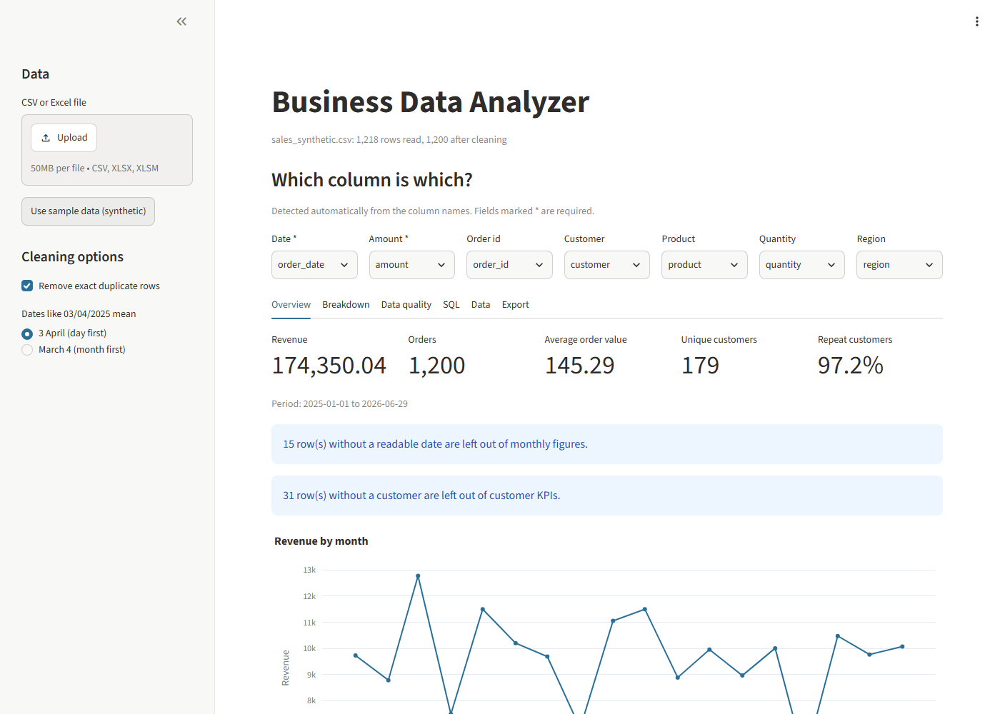
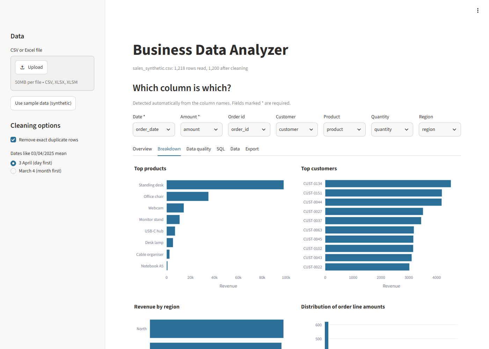
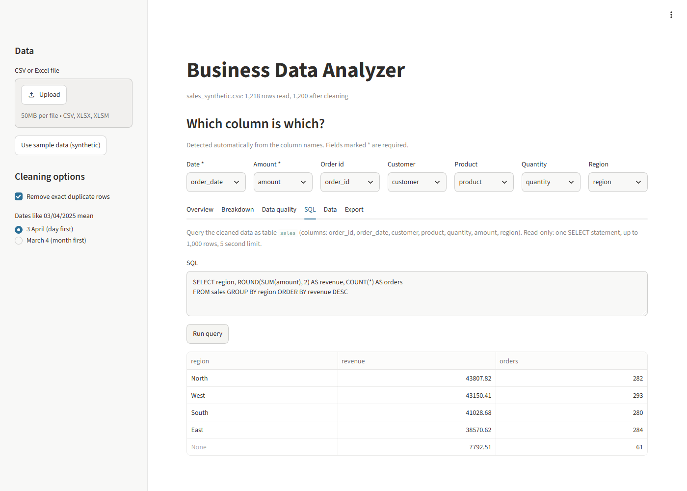
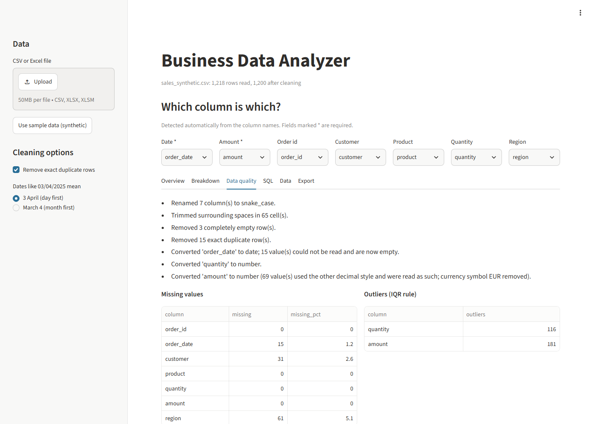
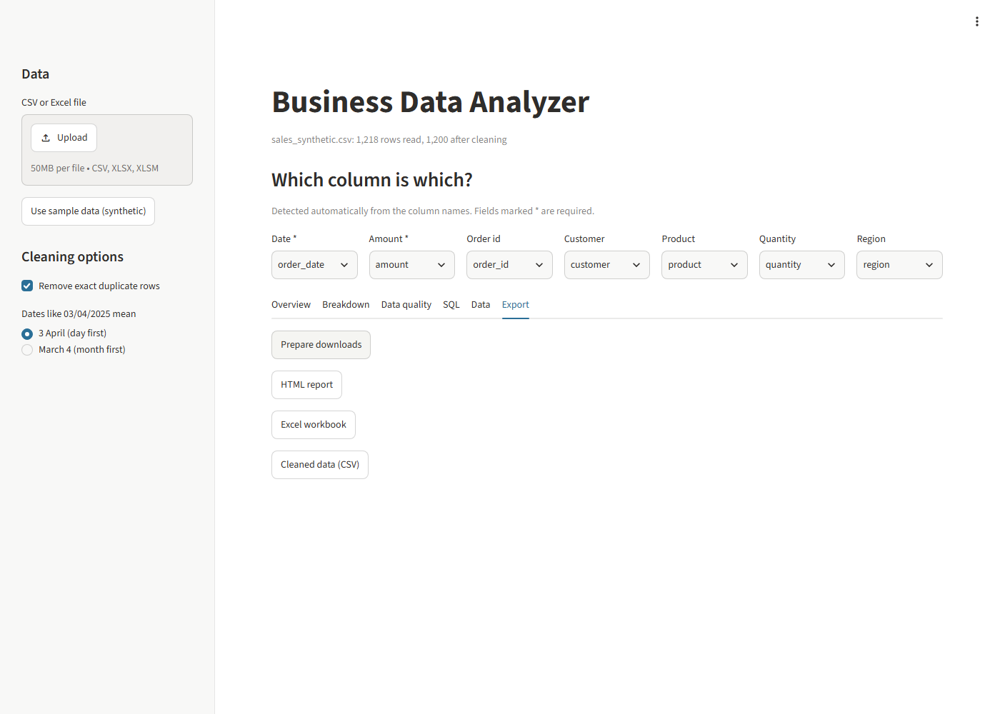

# Business Data Analyzer

Upload a sales export (CSV or Excel). The app cleans the messy parts, explains every change it made, calculates the usual sales KPIs and lets you query the data with SQL. Results can be downloaded as a self-contained HTML report, an Excel workbook or a cleaned CSV. It has a Streamlit web interface and a command line.

**Status:** complete as a portfolio project. Tested locally; not deployed publicly.
Built with AI assistance (Claude Code); see [Development notes](#development-notes).



## Features

- **Import:** CSV (comma, semicolon, tab or pipe; UTF-8 or Windows-1252) and Excel (`.xlsx`, `.xlsm`, with a sheet picker).
- **Cleaning that explains itself.** Every change is listed with a count:
  - column names normalised, spaces trimmed, and empty and duplicate rows removed (duplicate removal can be switched off)
  - numbers like `1,234.50`, `1.234,50`, `€ 99`, `(40.00)` and `2.5E+3` converted
  - dates like `2025-03-01`, `25/03/2025`, `01.02.2025` and `2025-01-31T23:30:00+02:00` converted
  - ids, zip codes and phone numbers kept as text, so `0042` stays `0042`
  - unreadable values counted, never silently dropped
- **Column mapping:** the date, amount, order id, customer, product, quantity and region columns are detected from their names and can be changed in the UI or with CLI flags.
- **KPIs:** revenue (net of refunds), orders, average order value, unique customers, repeat-customer rate, monthly revenue with month-over-month growth (partial months flagged), and top products, customers and regions with share of revenue.
- **Statistics:** missing values, descriptive statistics, outliers (IQR rule) and correlations.
- **SQL:** read-only DuckDB queries over the cleaned data, with time, memory and row limits.
- **Charts:** interactive Plotly charts in the app and in the report.
- **Exports:**
  - an HTML report that works offline
  - an Excel workbook with 7 sheets
  - a cleaned CSV, protected against spreadsheet formula injection

| Breakdown | SQL |
| --- | --- |
|  |  |
| **Data quality** | **Export** |
|  |  |

## Sample data

`samples/sales_synthetic.csv` (and a 300-row `.xlsx`) is **synthetic**: random data from a fixed seed, produced by [`scripts/make_sample.py`](scripts/make_sample.py). It does not describe any real business. It deliberately contains duplicated and blank rows, stray spaces, mixed number formats, two date formats and a few unreadable dates, so the cleaning step has something to show.

## Tech stack

| Area | Choice |
| --- | --- |
| Data | pandas 3, DuckDB (SQL), openpyxl (Excel) |
| Charts | Plotly |
| UI | Streamlit |
| Report | Jinja2 template, self-contained HTML |
| Tests | pytest, Streamlit AppTest |
| Quality | ruff (lint + format), mypy (strict), GitHub Actions |

## Run it

Requires Python 3.12 or newer.

```bash
python -m venv .venv
```

```bash
.venv/bin/pip install -e ".[dev]"
```

On Windows, use `.venv\Scripts\` instead of `.venv/bin/`.

**Web app:**

```bash
streamlit run app.py
```

Then open http://localhost:8501 and click **Use sample data (synthetic)**, or upload your own file.

**Command line:**

```bash
python -m analyzer report samples/sales_synthetic.csv --html out/report.html --xlsx out/report.xlsx --csv out/cleaned.csv
```

Useful flags:
- `--amount-column NAME` and the other `--<role>-column` flags override the detected columns.
- `--keep-duplicates` keeps duplicate rows.
- `--monthfirst` reads `03/04/2025` as March 4.

The CLI exits with code 2 and a readable message on bad input.

No environment variables or API keys are needed.

## Tests

```bash
pytest --cov=analyzer
```

```bash
ruff check . && ruff format --check . && mypy analyzer tests scripts app.py
```

96 tests, 97% line coverage. They cover:

- **Loading:** delimiters, encodings, BOM, Excel sheets, and size, row, column and cell limits.
- **Cleaning:** every number and date format above, ambiguous values, mixed currencies, identifiers kept as text, time zones, and the accuracy of the cleaning report.
- **KPIs:** hand-computed examples, refunds, orders without amounts, gap months, partial months, growth after zero or negative months, and empty data.
- **SQL safety:** writes, file and network access, extension installs, settings changes, multiple statements, timeouts, memory limits, and leaking server paths.
- **Exports:** the 7 workbook sheets, formula escaping (including behind control characters), and HTML escaping of `<script>`.
- **Hostile files:** a 1.5 KB Excel file claiming billions of cells, a sheet whose declared size hides data, zip bombs, and a CSV with millions of columns. Each must fail fast with a clear message.
- **The Streamlit app**, driven headlessly with AppTest: sample data, KPI values, the SQL tab, and mapping errors.
- **The CLI**, and that the sample generator is reproducible byte for byte.

[`scripts/screenshots.mjs`](scripts/screenshots.mjs) drives the running app in a real browser with Playwright to produce the screenshots above.

## Architecture

See [docs/ARCHITECTURE.md](docs/ARCHITECTURE.md): data flow, module responsibilities, cleaning rules, KPI definitions, SQL and export safety, and design decisions.

## Known limitations

- **Hardened, but not for hostile public use.** Uploads are size-limited and SQL runs with memory, thread, time and row limits, but everything runs in one process. Before letting strangers use it, run file parsing and queries in a separate worker process with an operating-system memory limit, and add authentication.
- **Excel dates stored as plain serial numbers** (e.g. `45658`) are not converted; real Excel date cells are.
- **The header must be on the first row**, and only one table per sheet is supported.
- **Order counting:** an order spanning two months counts once in each month. Orders that net to zero (fully refunded) are not counted as orders.
- **Amounts are not split by currency.** A column that mixes currencies is left as text with a warning, rather than adding euros to dollars.

## Development notes

This project was built with AI assistance (Claude Code). The workflow was:

1. **Architecture plan,** then implementation and tests.
2. **Separate automated code and security reviews.** The code review found wrong numbers in edge cases:
   - ids converted to numbers
   - European dotted dates read as numbers
   - accounting negatives dropped
   - unit price chosen as the amount
3. **Fixes.** Every confirmed finding was fixed with a regression test in [`tests/test_review_fixes.py`](tests/test_review_fixes.py) and [`tests/test_security.py`](tests/test_security.py). The security review found denial-of-service problems with crafted files and SQL, now fixed.
